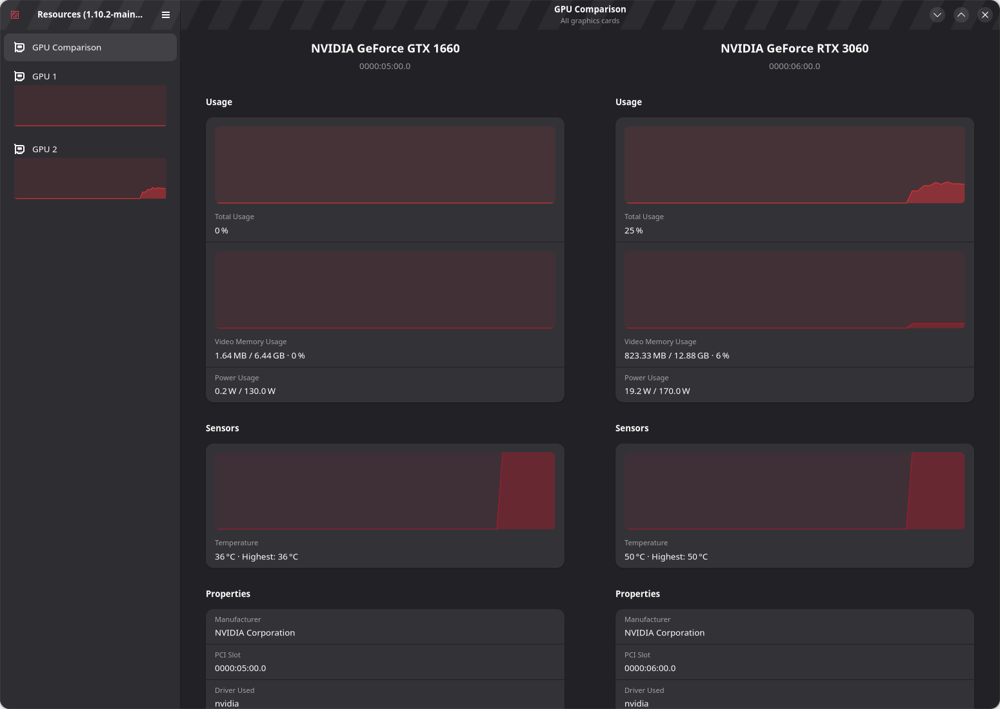
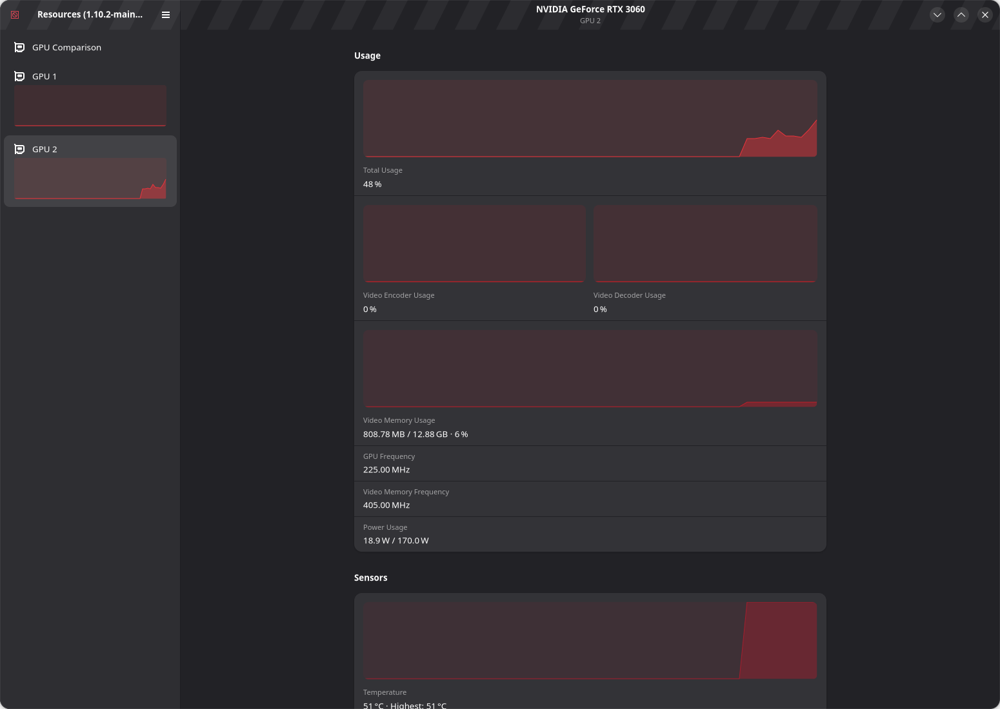

# Compare your GPUs

Resources was created by **[nokyan](https://github.com/nokyan)** and its contributors. This Ubuntu-tested fork builds on their work. **[Original repository](https://github.com/nokyan/resources)** · **[Current upstream development](https://gitlab.gnome.org/GNOME/Incubator/resources)** · **[Official app page](https://apps.gnome.org/app/net.nokyan.Resources/)**. This fork is independent and does not imply upstream or Ubuntu endorsement.

Open **GPU Comparison** in the sidebar. Each card gets its own column, labeled with its actual model name and PCI address. The view appears when Resources detects at least two graphics cards and GPU monitoring is enabled. Your existing individual GPU pages remain available.



## Tested with ComfyUI

We used this view alongside **[ComfyUI](https://github.com/Comfy-Org/ComfyUI)** to monitor local **Wan 2.1 T2V 1.3B video generation**: RTX 3060 as primary compute/display, with GTX 1660 or system RAM holding offloaded weights through our **[ComfyUI-MultiGPU branch](https://github.com/Cyclotron555/ComfyUI-MultiGPU/tree/hardware/3060-primary-safe-offload)**. The matched test generated 512×288, 33-frame videos. Resources displays the resulting hardware activity; ComfyUI and its extension manage model loading, inference and offloading.

## Read the view

- Each GPU has a distinct chart color; model and PCI labels also identify it.
- **Total Usage** shows how busy each GPU is; both usage charts use the normal 0–100% scale.
- **Video Memory Usage** shows used and total memory. Compare the printed amounts as well as the percentage: 50% of a 6 GB card differs from 50% of a 12 GB card.
- **Power Usage** and **Temperature** help distinguish active compute from storage/offloading. Both temperature graphs share a 0–100°C range, expanding together if a recorded reading exceeds 100°C. Equal temperatures now have equal graph heights; labels still honor your temperature-unit preference.
- **Details**, further down each column, include the vendor, driver, PCI slot and link information available to Resources.

The comparison omits video encoder/decoder graphs and frequency rows to keep usage, memory, power and temperature together. Those fields remain in each original GPU page. Scroll either column vertically to move all cards together and keep corresponding rows aligned. On narrow windows, scroll the whole comparison horizontally. Widen the window for an easier comparison.

An idle donor GPU can hold model weights without showing high utilization. This view reports activity; it neither chooses the compute GPU nor assigns AI offloading roles. GPU 1/GPU 2 are Resources labels, not guaranteed CUDA indices. Use model names and PCI addresses to identify cards. Missing readings keep upstream Resources' N/A handling.

## Build a separate development copy

Tested on Ubuntu 26.04 with GTK 4.22.4, libadwaita 1.9.1 and Rust 1.93.1. The upstream project declares GTK >=4.12, libadwaita >=1.8, and Rust >=1.85. Older Ubuntu releases may need newer libraries or the upstream Flatpak development environment.

On a suitable Ubuntu installation, install build dependencies:

```sh
sudo apt install build-essential cargo rustc rustfmt meson ninja-build pkg-config \
  gettext libgtk-4-dev libadwaita-1-dev libsoup-3.0-dev
```

Then build and run without replacing the distribution package:

```sh
git clone --branch feature/gpu-comparison https://github.com/Cyclotron555/resources.git
cd resources
./scripts/build-comparison.sh
./scripts/run-comparison.sh
```

The build uses a repository-local `local-install/` prefix and the upstream development application ID (`net.nokyan.Resources.Devel`), separate from the normal app. The striped development header is expected. No root access is needed for the build/install steps after dependencies are available. No driver, display assignment or power-management setting is changed.

To remove this copy, close it and delete its checkout/local-install directory. Your packaged Resources app remains installed. This does not delete any separate development-app preferences.

## Check and reproduce

```sh
meson test -C build --print-errorlogs
```

A documentation helper captures only this application's rendered window, not the desktop or other apps. Close other copies of the development app first, then run:

```sh
GSETTINGS_SCHEMA_DIR="$PWD/local-install/share/glib-2.0/schemas" \
RESOURCES_CAPTURE_PATH="$PWD/docs/screenshots/gpu-comparison.png" \
RESOURCES_CAPTURE_VERIFY=1 GSK_RENDERER=cairo \
./build/src/debug/resources-capture --open-tab-id gpu-comparison -p -d -n -b -c -m -v
```

It opens the real comparison UI, checks synchronized scrolling, the shared temperature range and distinct colors, waits for live readings, saves a PNG and exits. Omit RESOURCES_CAPTURE_VERIFY when capturing an individual GPU page. A graphical session is required. `-p` hides process/app monitoring for screenshot privacy; the other switches hide unrelated devices. The helper has no GPU-setting or process-control actions. It uses a 1550×1100 window so details are readable.

## Limitations

Only an RTX 3060 / GTX 1660 pair has been visually exercised for this fork. Single-GPU systems retain their normal page and do not show comparison. More than two GPUs scroll horizontally. GPU hotplug/reordering during a session is not newly supported; restart the app after a hardware change. Polling frequency, sensor behavior, graph history and existing per-GPU pages come from upstream Resources. Only comparison temperature charts use the shared range; individual pages retain their original automatic scaling.

This is an independent GPL-3.0-or-later fork, not an official upstream release. Upstream development now lives at [GNOME GitLab](https://gitlab.gnome.org/GNOME/Incubator/resources). See [CHANGELOG](GPU-COMPARISON-CHANGELOG.md) for exact scope and checks.

## Original GPU page

The full per-card view remains available, including encoder/decoder and clock readings:


